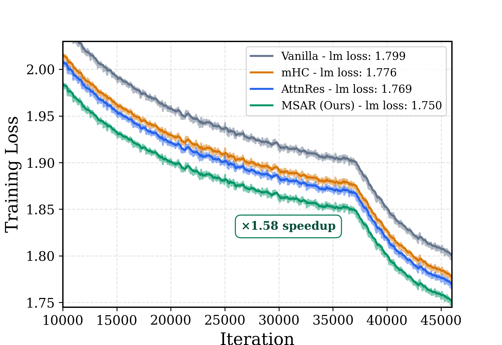
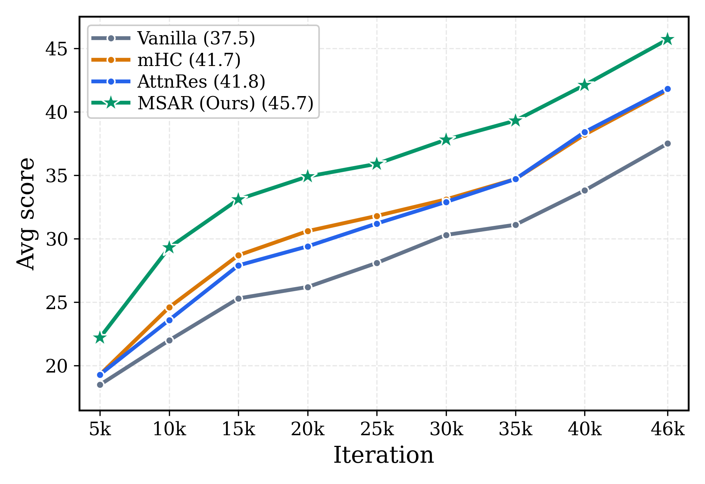
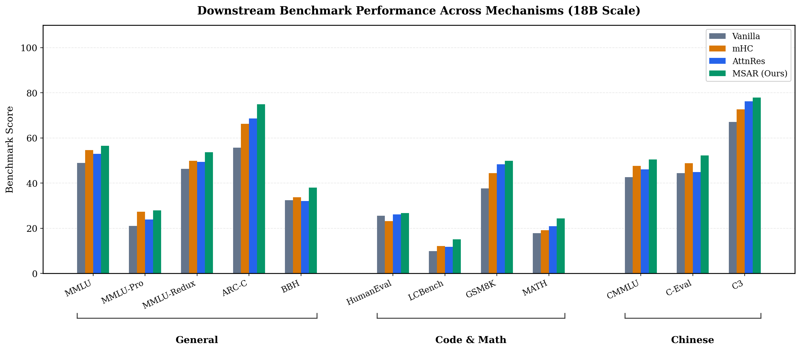

## The original

Figure 1's purpose is, quoting the paper, to show **'MSAR improves optimization and downstream performance at 18B scale'**. It's the opening figure of the paper, thus should visualize the paper's core contributions. 

The original figure has 3 graphs.
<table>
  <tr>
    <td align="center" width="33%"></td>
    <td align="center" width="33%"></td>
    <td align="center" width="33%"></td>
  </tr>
  <tr>
    <td align="center">(a) Training loss</td>
    <td align="center">(b) Average downstream score</td>
    <td align="center">(c) Per-benchmark performance</td>
  </tr>
</table>

Although all 3 figures weren't very hard to read, I did find a few issues with each.

**Subfigure 1 (a) Training loss**
Figure (a) presents a graph that compares 4 baseline residual architectures: Vanilla, mHC, AttnRes, and MSAR (paper's method). You can barely see the difference between mHC and AttnRes, they almost merge into a single line.
Also the improvements, although visible, aren't measurable. The reader would understand MSAR is much better than all other variants, but the 1.58× iso-loss compute speedup is not as visible. Highlighting the iso-loss speedup (or other major achievements) is crucial to attract readers.

**Subfigure 1 (b) Average downstream score**
Figure (b) is significantly easier to interpret, although also compares the same 4 baselines as figure (a).
The visual is free of unnecessary noise and cleanly captures all core ideas. The downstream performance metrics remain straightforward, and doesn't require extra annotations.

**Subfigure 1 (c) Per-benchmark performance**
The last figure was a lot to handle. It has 12 tiny labels, each having a different range (which requires many tiny details), creating visual clutter.
Differentiating between MSAR's improvements per benchmark category (general, code & math, and chinese) requires a close look at the spider chart and cross-referencing dataset names against categories.

## The redesign

<table>
  <tr>
    <td align="center" width="33%"></td>
    <td align="center" width="33%"></td>
    <td align="center" width="33%"></td>
  </tr>
  <tr>
    <td align="center">(a) Training loss</td>
    <td align="center">(b) Average downstream score</td>
    <td align="center">(c) Per-benchmark performance</td>
  </tr>
</table>

## What changed and why

**Subfigure 1 (a) Training loss**

1. Annotated MSAR's '1.58× speedup' over Vanilla to anchor the visual takeaway at first sight.
2. Changed range and adjusted line opacity, such that mHC and AttnRes don't collide.
3. Switched to a colorblind-friendly color palette.

**Subfigure 1 (b) Average downstream score**

1. Added a custom point marker (star shape) to MSAR baseline, to emphasize its higher average downstream score.
2. Switched to a colorblind-friendly color palette.

**Subfigure 1 (c) Per-benchmark performance**

1. Turned the spider chart into a grouped bar chart. That way, one can understand what's the actual difference between the benchmarks and wouldn't be overwhelmed by tiny details and multiple ranges of data.
2. Grouped benchmarks into clusters of the same category. This highlights where MSAR yields the largest relative gains.