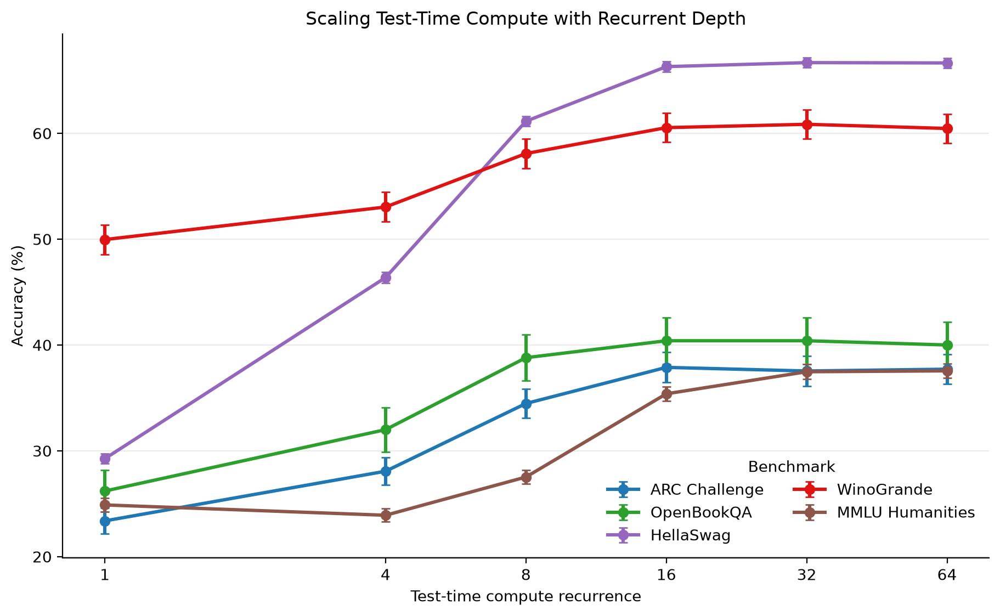

## What I reimplemented

Figure 1 shows different lm_eval metrics that have been evaluated for this model for different r values.
The recurrent value shows how many times does the embeddings pass through the recurrent block to generate the final answer.
Therefore, we implemented the graph for 2 of the 3 existing metrics and added 3 metrics of our own.
The new added metrics are chosen to be structed, multiple choice questions in realms that are not scientific;
which are different than the metrics in Figure 1.
The realms are of everyday and language commonsense. In addition, mmlu_humanities deals with philosophy, moral disputes, law, logic, history, religion and such.

## The code

I'll link to my fork of the project's github code, with the relevant branch of the source code under evaluations/ folder.

Full code: [link](https://github.com/shachar731945/recurrent-pretraining/tree/evaluations_plotting)

## Results

All metrics show a similar trending curve as the one described in Figure 1:
The model's perfromence increases dramatically up to r=16, especcialy from r=4 to r=8 and from r=8 to r=16.

Despite the model's training data being skewed towards scientific and programming data, the model's perfromence on humanities are comparable to OpenBookQA.
The 2 commonsense evaluations scored relatively high to scientific and humanities evaluations, which is expected by them not requiring specialied knowledge and/or training.

In regards to the 2 metrics that are in the article's Figure 1 as well, the results are very close but not exactly the same.
This might be due to random seed differences (mine was random and the article's wasn't specified)

## What I learned

The KV cache of generation takes a lot of memory effecting the memory requirements dramatically in varying r ranges.
This requires calibrating the evaluations for each metric and for each r values to not crash the evaluations run.

Furthermore, the various other metrics do re-enforce the idea that increasing r does improve results up to a degree;
while the results platue without increasing the dataset / model size and such

